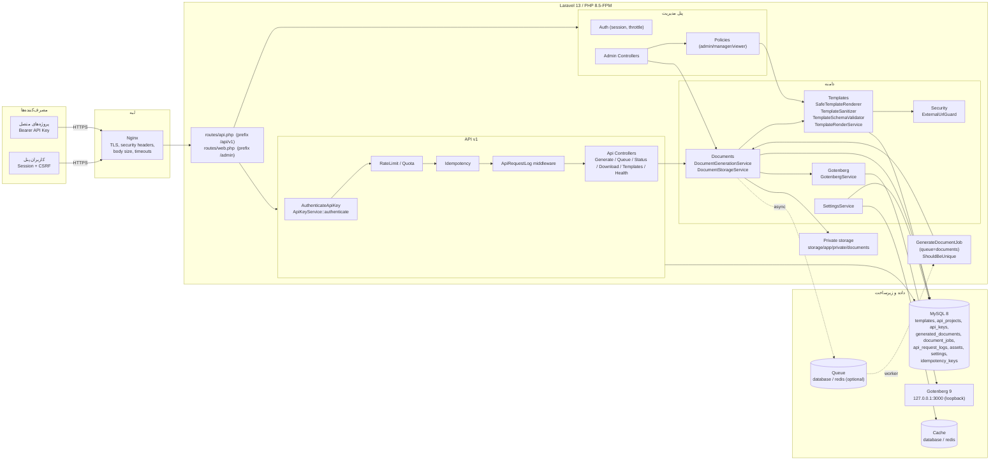
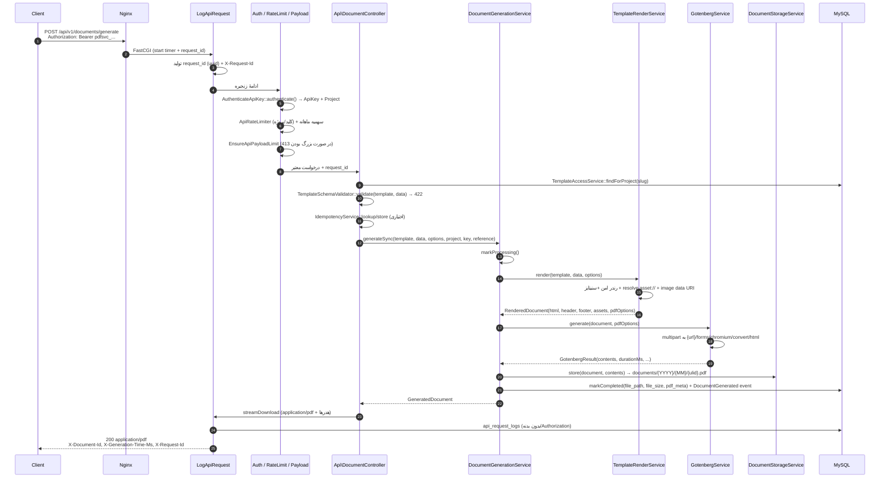
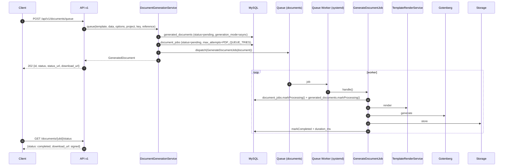
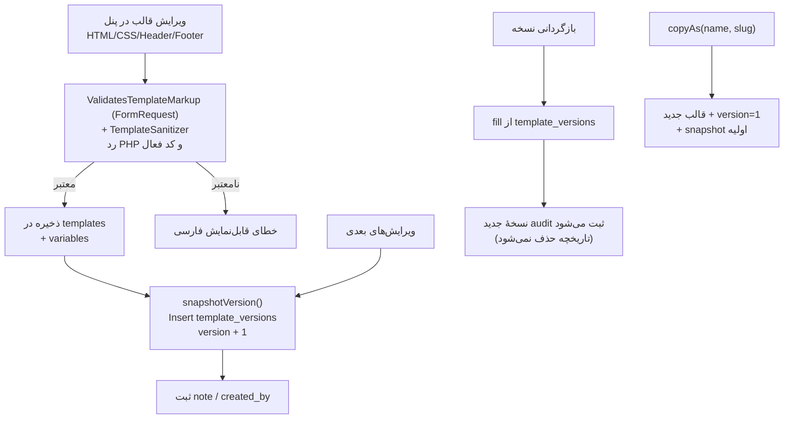
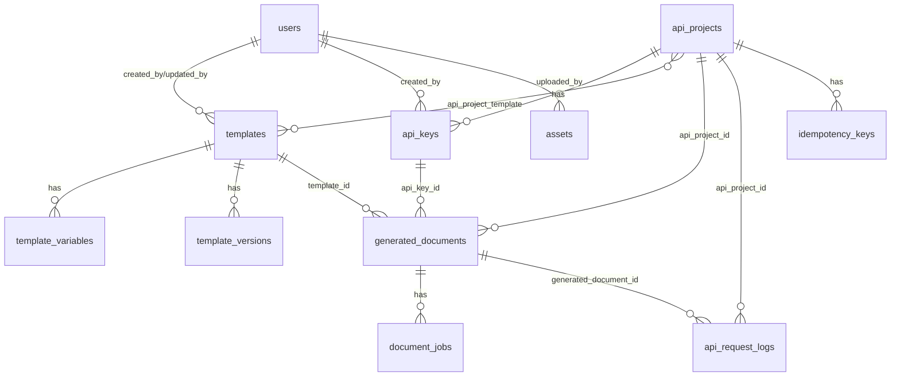

<div dir="rtl">

# معماری سرویس مرکزی تولید اسناد و PDF

این سند معماری داخلی سرویس را از دید فنی توضیح می‌دهد: مؤلفه‌ها، جریان درخواست، موتور امن قالب، ادغام با Gotenberg، ذخیره‌سازی خصوصی، مدل داده و تصمیم‌های طراحی. مرجع قراردادهای پیاده‌سازی: [CONTRACTS.md](CONTRACTS.md).

## ۱) نمای کلی مؤلفه‌ها



### مسئولیت مؤلفه‌ها

| مؤلفه | مسئولیت | فایل/کلاس‌ها |
|---|---|---|
| لایهٔ HTTP | مسیرها، middleware، اعتبارسنجی ورودی، پاسخ | `routes/api.php`, `routes/web.php`, `bootstrap/app.php` |
| احراز هویت API | تبدیل Bearer token به `ApiKey` معتبر | `app/Services/Api/ApiKeyService.php` (متد `authenticate`), `app/Http/Middleware/AuthenticateApiKey.php` |
| محدودیت نرخ/سهمیه | rate limit در سطح کلید + سهمیهٔ ماهانه پروژه | `app/Http/Middleware/ApiRateLimiter.php` |
| محدودیت payload | رد بدنهٔ بزرگ‌تر از `PDF_MAX_PAYLOAD_KB` با 413 | `app/Http/Middleware/EnsureApiPayloadLimit.php` |
| لاگ درخواست | `request_id`، هدر `X-Request-Id`، ثبت ردیف `api_request_logs` | `app/Http/Middleware/LogApiRequest.php` |
| خطاهای API | تبدیل throwableها به `ApiException` با کد/وضعیت استاندارد | `ApiController::handleApiErrors()`, `app/Services/Api/ExceptionMapper.php`, `app/Exceptions/ApiException.php` |
| امضای دانلود | اعتبارسنجی signed URL و پاسخ JSON در صورت امضای نامعتبر | `app/Http/Middleware/ValidateApiSignature.php` |
| پاسخ استاندارد | ساخت envelope موفق/ناموفق | `app/Services/Api/ApiResponseService.php` |
| Idempotency | هش درخواست، replay، رد بدنهٔ متفاوت | `app/Services/Api/IdempotencyService.php` |
| دسترسی قالب | لیست/یافتن قالب مجاز پروژه | `app/Services/Api/TemplateAccessService.php` |
| URLهای سند | status/signed download URL | `app/Services/Api/DocumentUrlService.php` |
| موتور قالب | رندر امن HTML + جایگزینی asset + اعتبارسنجی متغیرها | `app/Services/Templates/*` (`SafeTemplateRenderer`, `TemplateSanitizer`, `TemplateSchemaValidator`, `TemplateRenderService`, `AssetResolver`) |
| تولید سند | هماهنگی render → Gotenberg → ذخیره → وضعیت | `app/Services/Documents/DocumentGenerationService.php` |
| ذخیره‌سازی | مسیر خصوصی، خواندن/حذف/مسیر مطلق | `app/Services/Documents/DocumentStorageService.php` |
| Gotenberg | multipart به Chromium، timeout/retry، health | `app/Services/Gotenberg/GotenbergService.php` |
| صف | اجرای غیرهم‌زمان + ردیابی attempts | `app/Jobs/GenerateDocumentJob.php`, `document_jobs` |
| امنیت URL | جلوگیری از SSRF برای تصاویر اینترنتی | `app/Services/Security/ExternalUrlGuard.php` |
| تنظیمات | key/value نوع‌دار و کش‌شده | `app/Services/Settings/SettingsService.php` |
| پنل | CRUDهای مدیریتی با Policy | `app/Http/Controllers/Admin/*`, `app/Policies/*` |

## ۲) جریان درخواست تولید هم‌زمان (Sync)



> ترتیب middleware: `LogApiRequest` → `ForceJsonResponse` (گروه بیرونی همهٔ مسیرهای v1) و سپس برای مسیرهای محافظت‌شده `AuthenticateApiKey` → `ApiRateLimiter` → `EnsureApiPayloadLimit`. مسیرهای عمومی `health`, `docs`, `openapi.yaml` و دانلود signed (`ValidateApiSignature`) خارج از گروه Bearer هستند. خطاها در کنترلرهای API با `ApiController::handleApiErrors()` گرفته و با `ExceptionMapper` به `ApiException` استاندارد تبدیل می‌شوند (چون Laravel استثناها را در innermost routing slice رندر می‌کند).

- خطا در هر مرحله → `markFailed(error_code, error_message)` و پاسخ خطای استاندارد API (بدون stack trace در production).
- `payload` درخواست (داده‌های متغیر) به‌صورت **رمزنگاری‌شده** (`encrypted:array`) در `generated_documents.payload` ذخیره می‌شود.

### پاسخ استاندارد و نگاشت خطاها

- موفق: `{"success": true, "data": ..., "meta": ..., "request_id": "..."}`
- ناموفق: `{"success": false, "error": {"code": "...", "message": "...", "details": {}}, "request_id": "..."}`
- `ExceptionMapper` (`app/Services/Api/ExceptionMapper.php`) throwableها را به کد/وضعیت ثابت نگاشت می‌کند؛ `ApiController::handleApiErrors()` نتیجه را به `ApiException` تبدیل و throw می‌کند و `ApiException::render()` envelope استاندارد را می‌سازد. `ValidateApiSignature` برای امضای نامعتبر مستقیماً `403 SIGNATURE_INVALID` JSON برمی‌گرداند.

| وضعیت | نمونه کدها |
|---|---|
| 401 | `INVALID_API_KEY`, `UNAUTHENTICATED` |
| 403 | `FORBIDDEN`, `TEMPLATE_NOT_ALLOWED`, `SIGNATURE_INVALID` |
| 404 | `NOT_FOUND`, `TEMPLATE_NOT_FOUND`, `DOCUMENT_NOT_FOUND` |
| 409 | `DOCUMENT_NOT_READY`, `IDEMPOTENCY_REPLAY_UNAVAILABLE` |
| 410 | `DOCUMENT_EXPIRED` |
| 413 | `PAYLOAD_TOO_LARGE` |
| 422 | `VALIDATION_ERROR`, `TEMPLATE_INACTIVE`, `IDEMPOTENCY_KEY_REUSED`, `IDEMPOTENCY_KEY_INVALID` |
| 429 | `RATE_LIMIT_EXCEEDED`, `MONTHLY_QUOTA_EXCEEDED` |
| 5xx | `GOTENBERG_UNAVAILABLE` (503), `GOTENBERG_TIMEOUT` (503/504), `GOTENBERG_ERROR` (502), `RENDER_ERROR`, `STORAGE_ERROR`, `SERVER_ERROR` |

## ۳) جریان درخواست تولید غیرهم‌زمان (Async / Queue)



- `GenerateDocumentJob` از `ShouldBeUnique` با `uniqueId = pdf-document:{documentId}` (و `uniqueFor=3600`) استفاده می‌کند تا دوباره‌اجرای هم‌زمان رخ ندهد.
- `tries`/`timeout`/`backoff` از `config('pdf.queue.*')` می‌آیند و با `PDF_QUEUE_TRIES`/`PDF_QUEUE_TIMEOUT`/`PDF_QUEUE_BACKOFF` تنظیم می‌شوند.
- خطاهای غیرقابل retry (`TEMPLATE_NOT_FOUND`, `TEMPLATE_INACTIVE`, `VALIDATION_ERROR`, `RENDER_ERROR`) بلافاصله نهایی می‌شوند؛ سایر خطاها (`GOTENBERG_*`, `STORAGE_ERROR`, خطای غیرمنتظره) تا اتمام تلاش‌ها retry و سپس از طریق `failed()` نهایی می‌شوند.
- در صورت شکست نهایی: `document_jobs.status=failed` + `error_code/error_message`، `generated_documents.status=failed`، رویداد `DocumentGenerationFailed`؛ retry دستی از پنل (`/admin/queue`) یا `DocumentGenerationService::retry()`.
- `retry` فقط برای سند `failed` مجاز است، وضعیت را به `pending` برمی‌گرداند، job/ردیف جدید می‌سازد و دوباره dispatch می‌کند.

## ۴) جریان مدیریت قالب و نسخه‌بندی



> اعتبارسنجی قالب در دو لایه انجام می‌شود: لایهٔ پنل با trait `App\Http\Requests\Admin\Concerns\ValidatesTemplateMarkup` روی فیلدهای `html/css/header_html/footer_html` قبل از ذخیره، و لایهٔ موتور با `SafeTemplateRenderer`/`TemplateSanitizer` قبل از رندر. هیچ کلاس `TemplateValidator` جداگانه‌ای وجود ندارد.

- **نسخه‌بندی append-only:** جدول `template_versions` هیچ رکوردی را overwrite نمی‌کند؛ هر snapshot کامل شامل `html`, `css`, `header_html`, `footer_html`, `page_size`, `orientation`, `margins`, `pdf_options`, `variables` و `note` است (`Template::snapshotVersion()`).
- `revertToVersion()` محتوای نسخهٔ قدیمی را روی قالب جاری می‌نشاند و سپس **یک نسخهٔ جدید** ثبت می‌کند؛ بنابراین تاریخچه تغییر نمی‌کند.
- `copyAs()` قالب و متغیرهای آن را تکثیر می‌کند و نسخهٔ ۱ اولیه را ثبت می‌کند.
- سند تولیدشده `template_name` و `template_version` را به‌صورت snapshot ذخیره می‌کند؛ بنابراین حذف/تغییر قالب بعدی، سند تولیدشده را تغییر نمی‌دهد. فایل PDF نیز مستقل از قالب ذخیره می‌شود.

## ۵) موتور امن قالب (Threat Model)

هدف: اجرای قالب‌های HTML ذخیره‌شده در دیتابیس **بدون** تبدیل آن‌ها به کد اجرایی.

### مرز اعتماد

| ورودی | خطر | کنترل |
|---|---|---|
| HTML/CSS قالب (مدیر/manager) | کد اجرایی سمت سرور | رندرر اختصاصی بدون `eval`/Blade؛ رد `<?php`, `@php`, `<?`, `{!!}`, `@include`, `@extends`, `@inject`, `@use` |
| دادهٔ متغیرهای API | XSS در PDF/HTML | escape خودکار HTML در `{{ }}`، attribute‌ها و خروجی فیلترها |
| assethandleها | Path traversal | فقط `asset://handle` معتبر از جدول `assets`؛ مسیرها از DB خوانده می‌شوند، نه از ورودی |
| URL تصویر | SSRF / دسترسی به شبکهٔ داخلی | `ExternalUrlGuard`: فقط http/https، resolve DNS، رد private/reserved IP، محدودیت حجم/نوع/timeout |
| محتوای آپلود asset | فایل مخرب | اعتبارسنجی mime/پسوند/حجم + checksum؛ ذخیرهٔ خصوصی |

### زبان قالب

- متغیرها: `{{ expr }}` — همیشه HTML-escaped (به‌جز `nl2br` که ورودی را خودش escape می‌کند و سپس `<br>` درج می‌کند).
- فیلترها (`ExpressionParser::ALLOWED_FILTERS`): `number`, `jdate`, `jdatetime`, `upper`, `lower`, `trim`, `nl2br`, `default`, `truncate`, `json`.
- کنترل‌ها: `@if/@elseif/@else/@endif`, `@unless/@endunless`, `@foreach/@endforeach` (+ `loop.index/iteration/first/last/count/remaining` و پشتیبانی `key => value`), `@isset/@endisset`, `@empty/@endempty`, `@jdate`, `@date`, `@number`.
- عبارت‌ها: متغیر با/بدون `$`، دسترسی نقطه‌ای، ایندکس، `??`، مقایسه/منطقی/ریاضی، پرانتز، رشته/عدد/bool/null/آرایه. توابع فقط allowlist (`ExpressionParser::ALLOWED_FUNCTIONS`): `count`, `now`, `strlen`, `mb_strlen`, `round`, `abs`, `max`, `min`, `intval`, `floatval`, `jdate`, `jdatetime`, `number`, `date`.
- **ممنوع:** متد/کلاس/`$GLOBALS`/backtick/`eval`، include/extends/inject، خروجی خام HTML. ساختارهای ممنوعه (`<?`, `@php`, `@endphp`, `{!!}`, `@include`, `@extends`, `@inject`, `@use`, `@eval` ...) در `SafeTemplateRenderer::assertNoForbiddenConstructs()` و `TemplateSanitizer::assertNoForbiddenConstructs()` با پیام فارسی و شمارهٔ خط رد می‌شوند.
- متن رندر fail-safe است: متغیر ناشناخته `null` (خروجی خالی) می‌شود؛ عملیات نامعتبر (تقسیم بر صفر، مقایسهٔ ناسازگار) استثنای قابل‌نمایش می‌دهد.

### Sanitizer (پاک‌سازی دفاعی)

`TemplateSanitizer` قبل از ارسال به Gotenberg روی HTML/CSS خروجی اجرا می‌شود (و در پنل قبل از ذخیره):

- حذف کامل `<script>`, `<iframe>`, `<object>`, `<embed>`, `<applet>`, `<frame>`/`<frameset>` (به‌همراه محتوا)
- حذف attributeهای `on*`، `javascript:`/`vbscript:`، `data:text/html`، `expression()`، `-moz-binding`، `behavior:`
- حذف `<base>` و `meta http-equiv=refresh`
- حذف `<link rel=stylesheet>` خارجی، همهٔ `@import`های CSS و جایگزینی `url()` خارجی با `url('')`
- در attributeهای `href/src/...`: فقط URLهای نسبی، `#anchor`، `asset://handle` (با الگوی محدود) و `data:image|font|application` مجازند؛ بقیه خالی می‌شوند
- تصاویر اینترنتی **مستقیماً در CSS/HTML** مجاز نیستند؛ مسیر مجاز فقط از طریق متغیر نوع `image` و `ExternalUrlGuard` است (فایل با mime/حجم مجاز به `data:` تبدیل می‌شود).

### دفاع در عمق

1. **قبل از ذخیره:** validator/sanitizer قالب را رد/پاک می‌کند.
2. **قبل از رندر:** بار دیگر اعتبارسنجی/سنیتایز روی همان محتوا (defense in depth).
3. **هنگام رندر:** parser اختصاصی به‌جای Blade؛ هیچ template engine عمومی با PHP eval استفاده نمی‌شود.
4. **هنگام تولید:** Gotenberg در شبکهٔ جدا/loopback و فایل‌های ورودی فقط در multipart همان درخواست هستند.

### نشت اطلاعات

- خطای سینتکس/نامعتبر قالب → استثنای دامنه با پیام فارسی قابل‌نمایش؛ هرگز متن PHP خام یا stack trace به مصرف‌کننده نشان داده نمی‌شود.
- نام asset/URL خطادار در پیام خطای عمومی لو نمی‌رود (جزئیات فقط در log سرور).

## ۶) ادغام با Gotenberg

- نقطهٔ اتصال: `POST {GOTENBERG_URL}/forms/chromium/convert/html` (پیش‌فرض `http://127.0.0.1:3000`). پیاده‌سازی: `App\Services\Gotenberg\GotenbergService`.
- multipart fields (کلاینت Laravel HTTP):
  - `files`: `index.html` + `header.html`/`footer.html` (در صورت وجود) + همهٔ assetها با نام flatten‌شدهٔ `{handle}.{ext}` در ریشه
  - صفحه: `paperWidth`/`paperHeight` (اینچ؛ از میلی‌متر تبدیل می‌شود)، `marginTop/Right/Bottom/Left` (اینچ)
  - گزینه‌ها: `printBackground`, `scale`, `landscape`, `preferCssPageSize`, `displayHeaderFooter` — همه از `PdfOptions::toGotenbergFields()`
- `PdfOptions::fromTemplate()` اولویت‌ها: گزینه‌های درخواست API (`format`, `orientation`) → `pdf_options`/`margins` قالب → پیش‌فرض config. اندازه‌های Custom از `paper_width`/`paper_height` (میلی‌متر) خوانده می‌شوند.
- زمان‌ها: `GOTENBERG_CONNECT_TIMEOUT` و `GOTENBERG_TIMEOUT`؛ retry: تعداد تلاش = `1 + GOTENBERG_RETRY_TIMES`، با `GOTENBERG_RETRY_SLEEP_MS` و فقط برای خطای اتصال و پاسخ‌های `>= 500`.
- اعتبارسنجی خروجی: پاسخ 2xx باید با `%PDF` شروع شود، وگرنه `GOTENBERG_ERROR` (`502`).
- کدهای خطای دامنه: `GOTENBERG_UNAVAILABLE` (اتصال، 503)، `GOTENBERG_TIMEOUT` (timeout/408/504، 503/504)، `GOTENBERG_ERROR` (پاسخ نامعتبر/5xx، 502). این‌ها `GotenbergException` هستند و توسط `ExceptionMapper` به کد/وضعیت عمومی API نگاشت می‌شوند.
- `health()`: `GET /health` با timeout کوتاه (`health_timeout`/`health_connect_timeout` پیش‌فرض 5/2 ثانیه)، بدون پرتاب استثنا؛ خروجی `{ok, status, http_status, response_time_ms, error, checked_at}`. `HealthController` فقط `ok/status` را در پاسخ عمومی استفاده می‌کند (URL و جزئیات به مصرف‌کننده نمی‌رسد) و نتیجه ۶۰ ثانیه cache می‌شود.
- لاگ موفق: فقط `duration_ms`, `size`, `assets`, `format`, `landscape`؛ **هیچ‌گاه** HTML/PDF/دادهٔ حساس لاگ نمی‌شود. خطاها فقط `error_code`, `http_status`, `attempt`, `duration_ms`.
- دلیل انتخاب Gotenberg: ایزولهٔ Chromium، پشتیبانی کامل از CSS/فونت فارسی، و اجرای بدون سرویس‌های اضافه در PHP.
- دلیل loopback: جلوگیری از دسترسی عمومی به موتور رندر (که می‌تواند منبع مصرف CPU/حافظه باشد) و سادهٔ نگه‌داشتن مرز اعتماد.

## ۷) ذخیره‌سازی خصوصی و دانلود

- دیسک: `config('pdf.disk')` (پیش‌فرض `local`) با root `storage/app/private` — **خارج از `public`**. کلاس: `App\Services\Documents\DocumentStorageService` (`diskName()`, `store()`, `read()`, `exists()`, `delete()`, `absolutePath()`, `pathFor()`).
- مسیر: `{PDF_DOCUMENT_PATH}/{YYYY}/{MM}/{ulid}.pdf` (سال/ماه بر اساس `now()` هنگام ذخیره)؛ نام فایل ULID است، نه slug قالب/مشتری. هیچ بخشی از مسیر از ورودی کاربر ساخته نمی‌شود.
- دسترسی:
  - `GET /documents/{ulid}/download` با Bearer + بررسی مالکیت پروژه/وضعیت `completed`/عدم انقضا.
  - `GET /documents/{ulid}/download/signed` با URL امضاشدهٔ موقت (`PDF_SIGNED_URL_TTL` دقیقه) و middleware `ValidateApiSignature`؛ امضای نامعتبر/منقضی → `403 SIGNATURE_INVALID` (JSON استاندارد).
  - خروجی هر دو مسیر: `application/pdf` + `Content-Disposition: attachment` + هدرهای `X-Document-Id`, `X-Generation-Time-Ms`, `X-Request-Id`, `Cache-Control: no-store, private`.
- حذف: حذف منطقی رکورد (soft delete) + حذف فیزیکی فایل توسط سرویس/دستور نگهداری؛ فایل حذف‌شده قابل دانلود نیست.
- `expires_at` در سند: بعد از انقضا `canDownload()` منفی است و دانلود → `410 DOCUMENT_EXPIRED`.
- بکاپ: فایل‌ها زیر `storage` هستند و باید همراه بکاپ دیتابیس از این مسیر نیز پشتیبان گرفته شود.

## ۸) مدل داده (خلاصه و ستون‌های کلیدی)



### `users`
`role` (`admin|manager|viewer`, index)، `is_active`، `last_login_at`. غیرفعال‌سازی در `Gate::before` (AppServiceProvider) و middleware `active.user` اعمال می‌شود.

### `api_projects`
`code` unique، `is_active` (index)، `rate_limit_per_minute` (nullable = پیش‌فرض config)، `monthly_quota`، `last_activity_at` (index). پروژه بدون ردیف در `api_project_template` = دسترسی به همهٔ قالب‌های فعال.

### `api_keys`
`api_project_id` FK، `key_prefix`، **`key_hash` CHAR(64) unique** (HMAC-SHA256 با `API_KEY_HASH_SALT`)، `is_active`، `expires_at` (index)، `revoked_at`، soft delete. کلید خام ذخیره نمی‌شود؛ فقط یک‌بار در پاسخ ساخت/چرخش برمی‌گردد.

### `templates`
`slug` unique، `category` (index)، `is_active`، `locale`، `version`، `page_size`/`orientation`، `margins` JSON، `pdf_options` JSON، soft delete. ایندکس مرکب `(is_active, category)`.

### `template_variables`
`(template_id, name)` unique؛ `type`، `is_required`، `default_value`، `validation_rules`، `min_length/max_length`، `min_value/max_value`، `sort_order`.

### `template_versions`
`(template_id, version)` unique + `(template_id, created_at)` index؛ snapshot کامل + `variables` JSON + `note` + `created_by`.

### `api_project_template`
PK مرکب `(api_project_id, template_id)` — کنترل دسترسی قالب.

### `generated_documents`
- `ulid` unique (شناسهٔ عمومی)، `reference` (index)
- `api_project_id`, `api_key_id`, `template_id` FK (nullable)
- snapshot: `template_name`, `template_version`
- `generation_mode` (`sync|async`)، `status` (`pending|processing|completed|failed`, index)
- `file_path`, `file_size`, `mime_type`, `page_count`, `pdf_meta` JSON
- **`payload` = `encrypted:array`** (دادهٔ متغیرهای رمزنگاری‌شده)، `options` JSON
- `error_code`, `error_message`, `expires_at` (index)، `generated_at`، soft delete
- ایندکس‌ها: `(api_project_id, created_at)`, `(template_id, created_at)`, `(status, created_at)`

### `document_jobs`
ردیف ردیابی صف: `generated_document_id` FK، `queue`، `status` (index)، `attempts`، `max_attempts`، `available_at`، `started_at`، `finished_at`، `duration_ms`، `error_code/error_message`. ایندکس `(generated_document_id, created_at)` و `(status, created_at)`.

### `api_request_logs`
`request_id` (index)، FKهای project/key/template/document، `method/path/route_name`، `status_code` (index)، `duration_ms`، `request_bytes/response_bytes`، `ip_address`، `user_agent`، `error_code/message`، `created_at` (index). **بدنهٔ درخواست و هدر Authorization هرگز ذخیره نمی‌شود.**

### `assets`
`handle` unique (مرجع `asset://handle`)، `type` (`font|image|css|other`)، `mime_type`، `extension`، `size`، `disk`، `path` unique، `checksum` (index)، `metadata` JSON، soft delete.

### `settings`
`(group,key)`، `key` unique، `value` longText + `type` (`string|text|integer|float|boolean|json`)، `is_public`؛ دسترسی از طریق `SettingsService` با cache.

### `idempotency_keys`
unique `(api_project_id, key)`، `request_hash` (SHA-256)، `response_status`، `generated_document_id`، `expires_at` (index).

## ۹) تصمیم‌های طراحی و مبادله‌ها (Trade-offs)

| تصمیم | دلیل | هزینه/مبادله |
|---|---|---|
| موتور قالب اختصاصی به‌جای Blade | اجرای قالب‌های ذخیره‌شده در DB با Blade = اجرای کد PHP (RCE). رندرر اختصاصی سطح حمله را به یک گرامر کوچک محدود می‌کند | زبان قالب محدود است؛ هر قابلیت جدید باید آگاهانه به allowlist اضافه شود |
| Gotenberg به‌جای کتابخانهٔ PDF در PHP | کیفیت رندر CSS/فونت فارسی/صفحه‌بندی و جدایی نگرانی‌ها؛ Chromium ایزوله | وابستگی به سرویس خارجی؛ نیاز به مدیریت صف/حافظه و timeout |
| ذخیرهٔ خصوصی + دانلود کنترل‌شده | اسناد ممکن است دادهٔ شخصی داشته باشند؛ افشای URL احتمال بیشتری دارد | هر دانلود یک درخواست PHP می‌خواهد (سربار) |
| ULID به‌عنوان شناسهٔ عمومی | غیرقابل شمارش، زمان‌مرتب، قابل استفاده در URL | نیاز به unique index |
| HMAC کلید با salt پایدار | جستجوی O(1) روی `key_hash` بدون ذخیرهٔ کلید خام | تغییر salt همهٔ کلیدها را باطل می‌کند |
| صف database به‌صورت پیش‌فرض | راه‌اندازی ساده و بدون Redis؛ مناسب بار متوسط | رقابت/قفل روی دیتابیس در بار بالا؛ برای مقیاس، Redis بهتر است |
| `payload` رمزنگاری‌شده | کاهش اثر نشت دیتابیس/بکاپ | جستجوپذیری روی payload از بین می‌رود |
| Idempotency اختیاری | جلوگیری از دوبار تولید در retry شبکه | نیاز به TTL و پاک‌سازی دوره‌ای |
| Rate limit روی کلید | تفکیک مصرف‌کننده‌ها و سقف منصفانه | نیاز به ذخیرهٔ شمارنده (cache) و مراقبت از نبود throttle ناخواسته |
| Soft delete برای قالب/سند/کلید | حفظ تاریخچه و امکان بازیابی | نیاز به فیلترهای query و سیاست حذف فیزیکی/نگهداری |

## ۱۰) مقیاس‌پذیری

- **افقی:** PHP-FPM و Nginx بدون state هستند (session در دیتابیس/Redis)؛ می‌توان چند instance از app را پشت load balancer اجرا کرد. **فایل‌های PDF محلی هستند**؛ برای چند سرور باید دیسک مشترک (NFS) یا ذخیره‌سازی شیئی (S3) استفاده شود و کد storage از دیسک config پیروی می‌کند.
- **Queue:** برای بار بالا `QUEUE_CONNECTION=redis` و چند worker موازی:
  ```bash
  php artisan queue:work --queue=documents --tries=3 --timeout=180 --backoff=15 --max-jobs=500 --sleep=1
  ```
  هر worker یک فرآیند جدا؛ تعداد را با ظرفیت Gotenberg و CPU متعادل کنید (Chromium حافظه‌بر است).
- **Gotenberg:** گلوگاه اصلی است. `--chromium-...` و محدودیت هم‌زمانی Gotenberg را با تعداد workerها هماهنگ کنید؛ برای بار زیاد می‌توان Gotenberg را روی میزبان جداگانه (همچنان loopback/شبکهٔ خصوصی) اجرا کرد.
- **Cache:** `CACHE_STORE=redis` برای rate limit و settings در چند instance ضروری است (cache دیتابیس برای settings هم کافی است اما Redis سبک‌تر است).
- **دیتابیس:** ایندکس‌های `(status, created_at)`، `(api_project_id, created_at)` و `request_id` برای داشبورد/لاگ‌ها. `api_request_logs` و `document_jobs` رشد می‌کنند → سیاست نگهداری/آرشیو.
- **زمان‌بندی:** `php artisan schedule:run` هر دقیقه برای پاک‌سازی/نگهداری (systemd timer یا cron).

## ۱۱) قابلیت توسعه

- **قالب جدید:** از پنل (`/admin/templates` → ساخت) یا seeder؛ متغیرها + snapshot اولیه به‌صورت خودکار ثبت می‌شوند.
- **فیلتر/تابع جدید در موتور قالب:** افزودن به allowlist در `SafeTemplateRenderer` + تست امنیتی؛ هرگز `eval`/متد عمومی PHP اضافه نشود.
- **پروتکل asset جدید:** افزودن handler در `TemplateRenderService` (مثلاً `storage://`) با همان سخت‌گیری مسیر.
- **موتور PDF دوم:** پیاده‌سازی interface/کلاینت جایگزین در `app/Services/Gotenberg` با همان DTO/استثناها و انتخاب از config.
- **اعلان‌ها/اتصال به سیستم‌های دیگر:** `DocumentGenerated` و `DocumentGenerationFailed` رویدادها؛ listener جدید بدون تغییر سرویس اصلی.
- **فرمت‌های جدید صفحه:** `TemplatePageSize` و `config('pdf.page_formats')`.
- **افزودن متغیر با نوع جدید:** `TemplateVariableType` + قواعد اعتبارسنجی در `TemplateVariable::validationRules()`.

## ۱۲) پایش‌پذیری معماری

- `api_request_logs`: هر درخواست API (بدون محتوای حساس) با `request_id`، زمان پاسخ، حجم و وضعیت.
- `document_jobs`: هر اجرای صف با `attempts`, `duration_ms`, `error_code`.
- `generated_documents`: وضعیت نهایی و `pdf_meta` (مثلاً تعداد صفحه/زمان Gotenberg).
- لاگ فایل: `storage/logs/laravel.log` (daily rotation)؛ جزئیات بیشتر در [OPERATIONS.md](OPERATIONS.md).
- سلامت: `/up`، `/health`، `/api/v1/health` (وضعیت DB + Gotenberg).

</div>
